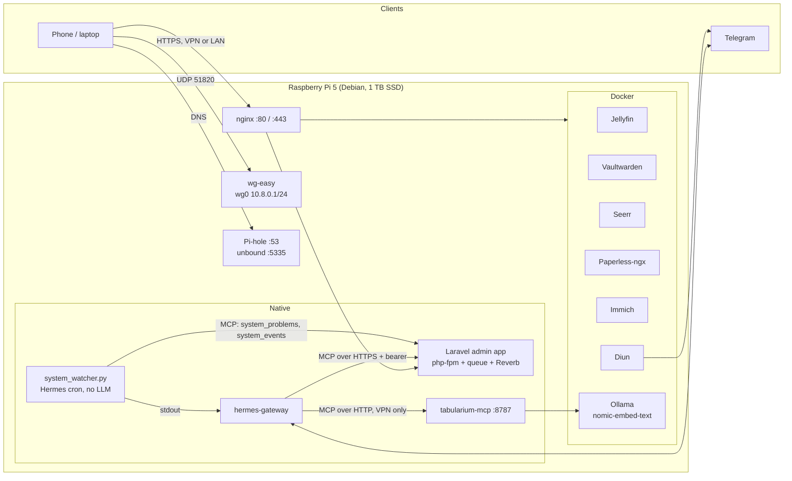
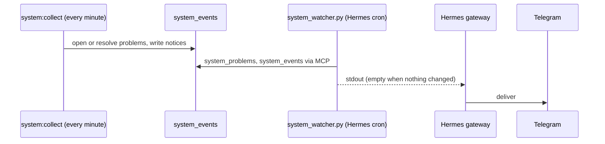

# Raspberry Pi homelab and its agent layer

This repo is a sanitized copy of how my home server is built: a Raspberry Pi 5 that runs DNS, a VPN, a handful of self-hosted apps, and the plumbing that lets an AI agent read and act on it. Hostnames, addresses, keys and personal data are replaced with placeholders (`home.example.com`, `192.168.1.10`, `203.0.113.10`, `changeme`). Everything else is what runs.

It is meant to show how the pieces fit: the network layout, the hardening, and the MCP servers an agent calls to read wellbeing, training and system data. It is not a turnkey installer, and it has not been run in this sanitized form.

## Related project

The Hermes configuration here connects to [Tabularium's v1 MCP server](https://github.com/simkaz12/tabularium) for memory. Tabularium's README also covers v2, which integrates with my [T3 Code fork](https://github.com/simkaz12/t3code).

## Architecture



## What runs where and why

The Pi does everything. One box keeps the failure modes simple, and a 16 GB board with an SSD has enough room for all of it.

| Layer | What | Why |
| --- | --- | --- |
| VPN | wg-easy (Docker, host network) serving `10.8.0.0/24` | The only public service besides HTTPS. Everything private is reached through it. |
| DNS | Pi-hole on :53, unbound as its only upstream on `127.0.0.1:5335` | Ad blocking, plus split-horizon names for the internal vhosts. unbound resolves recursively, so no third-party resolver sees the queries. |
| Ingress | nginx on :80 and :443, native | Terminates TLS (Let's Encrypt, wildcard for the internal names), proxies to loopback-only containers. |
| Apps | Vaultwarden, Seerr, Paperless-ngx, Immich, Diun, Jellyfin | Docker, published on `127.0.0.1` only. Helper containers (databases, Redis, Tika, Gotenberg) publish no ports. nginx is the sole way in. |
| AI | Ollama with `nomic-embed-text` | Embeddings for the memory MCP server. No chat models run on the Pi. |
| Memory | Tabularium MCP server (systemd, port 8787, bound to the VPN address) | Long-term memory for agents, separate project. Listed here because Hermes consumes it. |
| Admin app | Laravel app with MariaDB, Redis, a queue worker, Reverb websockets | Dashboard, health collector, and the host of the MCP servers in `agents/mcp`. |
| Agent | Hermes Agent gateway (systemd) | Telegram front end for the agent, calls the MCP servers. |

Docker data lives under `/mnt/media/apps/<name>`, so rebuilding a container never touches state. Docker's json-file logs rotate at 20 MB times three files.

Restarting the Docker daemon drops the VPN, because wg-easy owns `wg0`. Run it detached and reconnect after about 45 seconds:

```bash
sudo systemd-run --unit=docker-restart-once --collect sh -c 'systemctl restart docker'
```

## How agents reach the system

The admin app exposes three MCP servers over streamable HTTP (JSON-RPC over POST, built on `laravel/mcp`). They live in `agents/mcp`. The app is a self-hosted Laravel admin app, and this repo only lifts the integration code out of it. The rest of the app (dashboard, media, files) is not part of this showcase.

| Server | Path | Purpose | Tools |
| --- | --- | --- | --- |
| `pi-oura` | `/mcp/oura` | Stored ring data from the Oura API | `oura_connection`, `wellbeing_context`, `oura_data` |
| `pi-training-nutrition` | `/mcp/training-nutrition` | Training plans, performed sessions, food and drink log | `training_profile`, `training_plan`, `training_session`, `nutrition_log`, `training_nutrition_data` |
| `pi-system` | `/mcp/system` | Read-only Pi health: problems, snapshot, event log | `system_status`, `system_problems`, `system_events` |

Each route stacks two middlewares. `vpn` rejects any client address outside `10.8.0.0/24` and loopback. Then a per-server bearer-token check runs with `hash_equals`: 503 when the token is not configured (fail closed), 401 when the header is missing, 403 on a mismatch. A GET returns 405 on purpose. PHP-FPM cannot hold long-lived SSE streams, and a shim that closed them immediately sent MCP clients into a reconnect loop.

Design rules that show up in the tool descriptions, because the agent reads them:

- Missing data is unknown, never zero. Every wellbeing response carries coverage and freshness.
- The agent proposes, the owner accepts. `training_plan.save` never activates a plan.
- Deletion is two steps. `delete_preview` returns a single-use, ten-minute token for the exact range, and `delete_confirm` consumes it.
- Profile edits carry a `request_id` and an `expected_version`, so a retried tool call cannot double-apply or overwrite a newer version.

The Oura integration (OAuth, backfill, reconciliation windows, retention) is in `agents/oura`. Stored workouts from Oura are matched to sessions the agent logs by time overlap, in `agents/mcp/training-nutrition/module`.

## Hermes and the Telegram flow

Hermes Agent is NousResearch's open-source project, [NousResearch/hermes-agent](https://github.com/NousResearch/hermes-agent). I run v0.21.7 as is. I did not write it.

What I added around it:

1. The MCP servers it calls (`agents/mcp`), plus a registration block in its config (`agents/hermes/config.example.yaml`).
2. `agents/hermes/system_watcher.py`, a Hermes `no_agent` cron script. Every minute it calls `system_problems` and `system_events` on the system MCP server and prints a Telegram message only when something changed. No model runs on that path.
3. Control-center switches in the admin app. Each switch is a row in a `system_switches` table. For a Hermes job, flipping it queues a job that runs `hermes cron pause <id>` or `hermes cron resume <id>`. A failed apply reverts the row and writes a notice event. The collector reads the real job state back every minute, so the UI shows "pending" until it matches. See `agents/mcp/system/module/Jobs/ApplySwitch.php`.

The flow for an alert:



The watcher alerts once per critical problem, after it has been critical for five minutes, and sends one RESOLVED line when it clears. Warnings never reach Telegram. Its first run only records a baseline, so a restart does not replay old notices. The Laravel app never calls the Telegram Bot API. It writes notices to a table, and Hermes owns the channel. Diun is the one exception: it posts image-update reports to Telegram on its own.

Setup steps for the watcher are in `agents/hermes/README.md`.

## Security model

- **VPN first.** Only SSH (22), DNS (53), HTTP and HTTPS (80, 443) and WireGuard (51820/udp) are open to the world. SSH is not forwarded at the router. Admin ports (Pi-hole 8053, wg-easy 51821) and the memory MCP port (8787) accept only LAN and VPN sources. `infra/hardening/ufw.sh` is the full rule set: default deny incoming, deny routed, and routing allowed only between `eth0` and `wg0`.
- **Split-horizon DNS.** A wildcard record in Pi-hole answers `*.home.example.com` with the Pi's LAN address, so clients using Pi-hole (LAN and VPN) reach the internal names directly. A client outside gets nothing useful: nginx closes the connection with 444 for any source that is not LAN or VPN. See `infra/dns`.
- **444 for unknown hosts.** The internal vhosts allow loopback, `10.8.0.0/24` and `192.168.1.0/24` (the router address is denied explicitly) and turn every 403 into nginx's 444, which closes the connection without a response. A catch-all default server rejects the TLS handshake for any name nginx does not serve. Dotfiles and project files such as `.env` and `composer.json` get 444 as well.
- **Layered app access.** Port 443 is open to the internet for the app name, but the app answers 403 to non-internal addresses, registration is closed, and the MCP routes need a VPN source plus a bearer token.
- **fail2ban.** Jails for `sshd`, `nginx-botsearch` and a custom `nginx-4xx-burst` (20 responses of 403, 404 or 444 in five minutes, six-hour ban). The nginx jails ban ports 80 and 443 only, so a false positive never cuts SSH or WireGuard. LAN and VPN ranges are ignored.
- **Unattended upgrades.** Debian security origin only, unused dependencies removed, automatic reboot at 04:00.
- **Secrets.** Compose files read `${VARIABLES}` from an untracked `.env` (mode 600). Oura tokens are stored with Laravel's `encrypted` cast. Every `.env.example` here holds `changeme`.
- **Rate limits.** nginx defines per-address zones for general requests (`10r/s`), auth (`5r/m`) and concurrent connections (`infra/nginx/rate-limits.conf`).

## Image pinning

| Image | Pin | Reason |
| --- | --- | --- |
| `wg-easy` | `:14` | v15 is a rewrite that drops the `WG_*` environment variables. Migrating is its own task. |
| `jellyfin` | `:10.11` | The 12.x line disables legacy auth, so the upgrade is its own task. |
| Immich Postgres and Valkey | tag plus sha256 digest | The database image bundles vector extensions that must match the server release. A moving tag could break an upgrade silently. |
| `gotenberg`, `tika` | exact tags | Helper services for Paperless-ngx (Office and email conversion, text extraction). |
| Everything else | `latest` or `release` | Diun scans running containers daily at 08:00 and reports new digests to Telegram. I read the changelog, then pull. |

## Repository layout

```
infra/wireguard/   wg-easy compose and peer onboarding notes
infra/stacks/      compose files: infra, apps, ai (with .env.example)
infra/nginx/       internal-only vhosts, app vhost, Reverb proxy, unknown-host reject
infra/dns/         Pi-hole dnsmasq wildcard, unbound config
infra/hardening/   ufw script, fail2ban jails, unattended-upgrades
infra/systemd/     queue, Reverb, live watchers, hermes-gateway, tabularium-mcp
agents/mcp/        MCP servers and tool classes (PHP), middleware, config, per-server README
agents/hermes/     Hermes config example, system_watcher.py and its tests
agents/oura/       Oura OAuth, sync commands, jobs and services (PHP)
```

The PHP code is lifted from the Laravel app and will not run without it (models, migrations and the rest of the framework glue are not included). Treat it as integration code to read. The Python watcher is self-contained, and its tests run with `python3 -I agents/hermes/test_system_watcher.py`.

## Left out on purpose

Migrations, frontend, tests for the PHP code, the app's other modules, and any data. Real hostnames, addresses, peer lists, tokens and account identifiers are replaced or absent.

